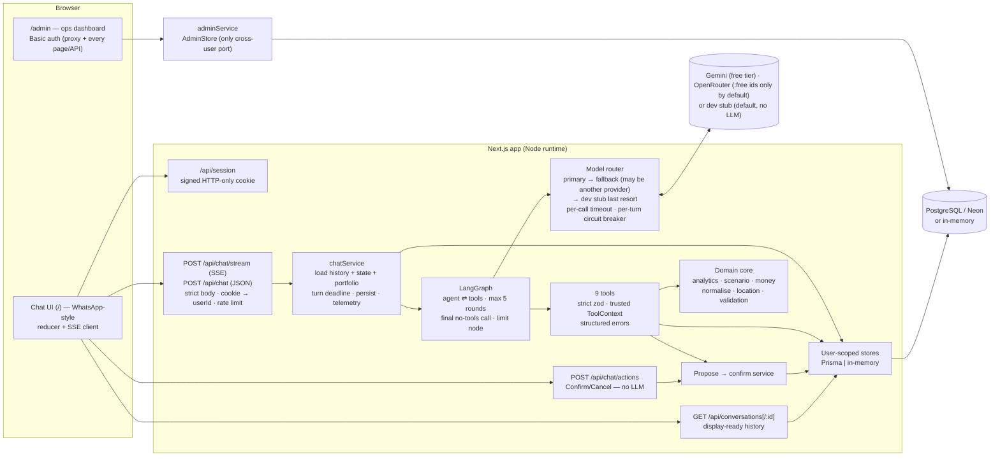
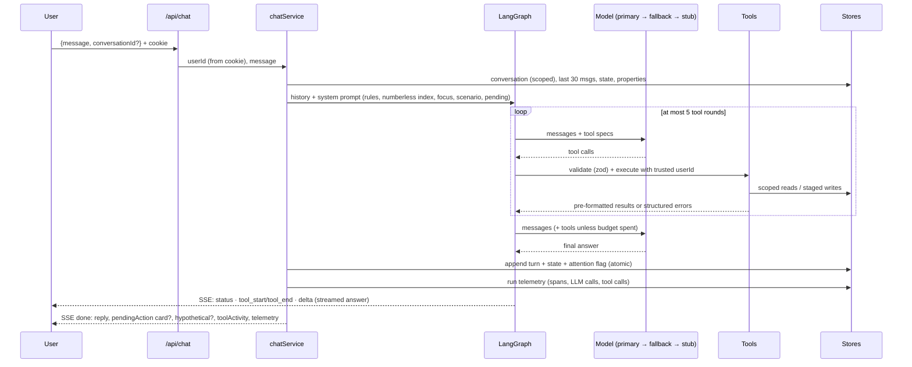

# Architecture

> All components below are built. Deployed on Vercel + Neon in **stub mode** (`LLM_PROVIDER=stub`, no LLM). See the README for what has and has not been verified against real services — in particular, no real Gemini/OpenRouter call is part of any automated test.

## One turn

## Key invariants (enforced in code, covered by tests)

- **User scoping.** The user id comes only from the signed cookie. Tool and API schemas are strict, so an injected `userId` is rejected. Every store query filters by `userId`, so another user's record looks the same as one that doesn't exist.
- **Numbers.** Every figure comes from `src/domain`. Tools return pre-formatted strings, and the prompt's property index has no numbers.
- **Hypotheticals.** Scenarios run on a cloned portfolio and are tagged `hypothetical: true`. They have no path to the database.
- **Writes.** Every write needs a pending action. Confirmation happens in a later turn, with either a clear yes or the button, which never calls the LLM. Writes are transactional and use optimistic locking.
- **Bounded execution.** At most 5 tool rounds. Each model call has its own timeout and the turn has an overall deadline; the user always gets a reply.
  - **Model failures:** a failing model moves on to the fallback (which may be another provider), then to the labelled dev stub when the last resort is enabled.
  - **Account errors:** a 401/402 is never retried on the same provider for the rest of the turn, including later tool rounds.
  - **Per-turn circuit breaker:** a model that failed is not called again in that turn.
  - **Visibility:** a stub last-resort answer flags the conversation `model_degraded`.
- **Free-only by default.** `LLM_PROVIDER=stub` builds no model client. OpenRouter model ids must end in `:free` unless `OPENROUTER_ALLOW_PAID=true` (default off); the evaluation runner enforces the same rule. Keys are never logged or shown; provider errors are redacted before storage.
