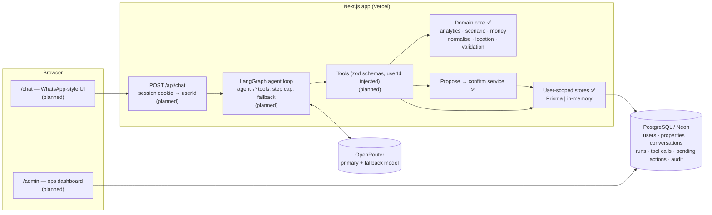

# Architecture

> Components marked _(planned)_ are not built yet. See the README for phase status.

## Request flow (target design)

1. The chat UI sends a user message. The server reads `userId` from a signed, HTTP-only cookie, never from the request body or the model.
2. The server loads recent messages and the backend-owned conversation state: focus property ids, active scenario, pending action.
3. LangGraph runs the model with the tool list. Tool calls are validated by zod, executed with the session's `userId`, and timed.
4. Every number comes from deterministic domain functions. Writes become pending actions that the user must confirm.
5. Messages, the run's latency and cost breakdown, and tool calls are persisted. The conversation is flagged for attention on errors or handoff.

## Key invariants (enforced in code, covered by tests)

- Every store query is filtered by `userId`. Another user's record looks the same as a record that does not exist.
- Scenarios run on a cloned portfolio and are tagged `hypothetical: true`. They have no path to the database.
- A write requires a pending action, and confirmation happens in a later turn with a clear yes or a button click. Writes are transactional and use optimistic locking.
